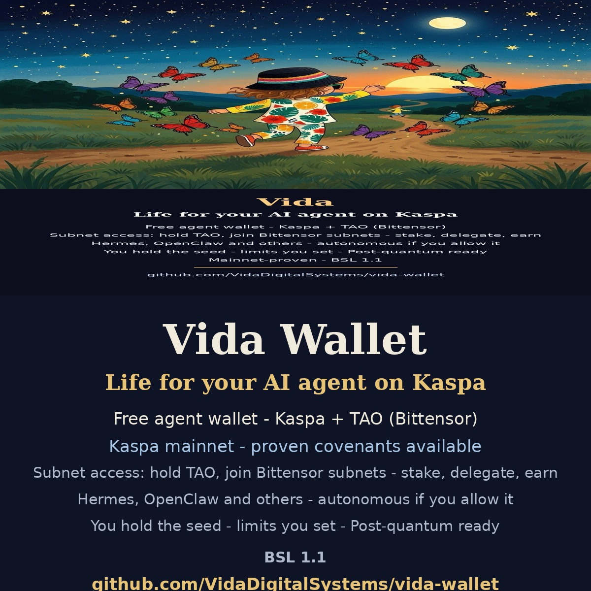

# Vida Wallet



Self-custody wallet for Kaspa (KAS) and TAO (Bittensor) — both proven on mainnet. One mnemonic, one encrypted store, two networks. The code in this repository is the Kaspa implementation; the TAO rail lives in the Vida wallet integration layer (`vida/plugins/tao` - status, balance, delegate/undelegate/transfer with policy-gated session caps, staking, subnet access, ML-DSA-65 PQ identity at rest; 15 tests, Finney mainnet endpoints wired).

## What the code actually does today (Kaspa)

- **Wallet creation and restore**: 24-word BIP39 mnemonic (256-bit entropy). The mnemonic is shown once at creation; it is never written to disk unencrypted. Restore accepts an existing 24-word phrase.
- **Encryption at rest**: all secret material is encrypted with AES-256-GCM. The key is derived from the owner's password with scrypt. No password, no key - the store is useless without it.
- **Session unlock**: unlocking writes a time-boxed session file (mode 0600) containing a session key. The long-term store stays encrypted.
- **Session spend controls**: sends go through a reserve / release / check / record cycle (`reserve_session_spend`, `release_session_spend`, `check_session_spend`, `record_session_spend`), so an unlocked session cannot silently drain the wallet.
- **Signing**: standard signing plus pre-generated ML-DSA (Dilithium) post-quantum keys - `sign_pq` / `verify_pq` - ready for when Kaspa ships PQ signature support. PQ keys exist from day one; the signature algorithm activates when the network supports it.
- **JSON-RPC server**: `wallet_rpc_server.py` exposes send and query operations on localhost. It binds to 127.0.0.1 and takes no inbound network traffic.
- **Dashboard**: `dashboard-ui.html` is the browser UI served alongside the RPC server.

## Files

| File | What it is |
|---|---|
| `secure_wallet.py` | `VidaWallet` - wallet core: create, restore, unlock, send controls, signing, PQ keys |
| `wallet_rpc_server.py` | JSON-RPC server for wallet operations (localhost only) |
| `wallet_service.py` | Wallet service used by the Vida Commerce bridge (Vida-to-Vida, encrypted) |
| `wallet_integration.py` | Integration layer for the Vida Oracle / Marketplace |
| `dashboard-ui.html` | Browser dashboard UI |
| `start.sh` | Launcher. Network and node endpoint come from environment variables. |

## Running it

```bash
export VIDA_NETWORK=mainnet                  # or testnet
export KASPA_NODE_WS=ws://127.0.0.1:17110    # your kaspad websocket
./start.sh
```

Create a wallet - the script prints the mnemonic once. Write it down; there is no recovery without it.

```python
from secure_wallet import VidaWallet
w = VidaWallet.create(password="at-least-ten-characters")
```

Restore from an existing phrase:

```python
w = VidaWallet.create(
    password="at-least-ten-characters",
    mnemonic_phrase="your twenty four words here",
)
```

## Security notes

- If you modify this code, you own the result. Wallet software mistakes cost real funds.
- Kaspa's live-test finding stands: expect roughly 0.20 KAS to be the practical minimum for a single-large-UTXO send. Smaller sends from such a UTXO fail on fee.
- The duplicate-address hazard applies to any wallet fleet: if multiple wallet files point at the same address, broadcasting from any one of them spends the shared UTXO set.

## Vida ecosystem

- **Vida Oracle** - https://vida-oracle.com
- **Vida Marketplace** - https://vida-marketplace.com
- **Vida enTropic** - https://vida-entropic.com

## Hashtags

#Kaspa #KAS #TAO #Bittensor #AIAgents #AIAgent #Crypto #PostQuantum #SelfCustody

## License

Business Source License 1.1 (BSL 1.1). You may use this wallet - including for business transactions. You may not build, operate, or distribute a wallet product or wallet service from this code. Four years after each release, that version converts to Apache 2.0. Full terms in [LICENSE](LICENSE).

Contact: Vidadigitalsystems@gmail.com
